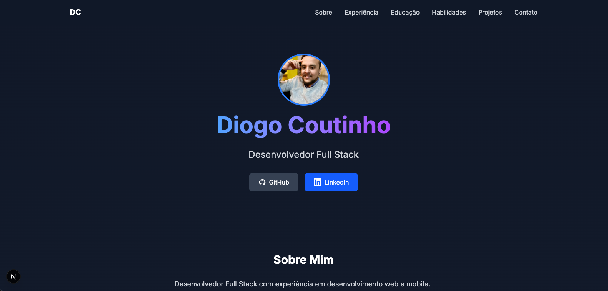

# Diogo Coutinho - Portfólio Pessoal



Um portfólio moderno e responsivo desenvolvido com Next.js, TypeScript e Tailwind CSS. Este projeto apresenta minha trajetória profissional, habilidades, projetos e informações de contato.

## 🚀 Tecnologias Utilizadas

- **Framework**: [Next.js](https://nextjs.org/) - Framework React para produção
- **Linguagem**: [TypeScript](https://www.typescriptlang.org/) - Superset tipado de JavaScript
- **Estilização**: [Tailwind CSS](https://tailwindcss.com/) - Framework CSS utilitário
- **Deploy**: [GitHub Pages](https://pages.github.com/) - Hospedagem estática
- **Ícones**: [Heroicons](https://heroicons.com/) - Biblioteca de ícones
- **Animações**: [Framer Motion](https://www.framer.com/motion/) - Biblioteca de animações

## ✨ Funcionalidades

- Bilíngue (PT-BR / EN-US) com SEO por idioma (Open Graph, `hreflang` e JSON-LD `Person`)
- Seções: hero com proposta de valor, números, sobre, serviços, cases e produtos, experiência, stack, formação e contato com CTAs
- Currículo em PDF gerado no navegador, em coluna única e legível por ATS, no idioma ativo
- Modo escuro e animações com Framer Motion

## 🛠️ Instalação

1. Clone o repositório:

```bash
git clone https://github.com/diogocoutinho/diogocoutinho.github.io.git
cd diogocoutinho.github.io
```

2. Instale as dependências:

```bash
npm install
# ou
yarn install
```

3. Execute o projeto em desenvolvimento:

```bash
npm run dev
# ou
yarn dev
```

4. Acesse [http://localhost:3000](http://localhost:3000)

## 📦 Deploy para GitHub Pages

1. Certifique-se de que o repositório está configurado para GitHub Pages:

   - Vá para Settings > Pages
   - Selecione a branch `gh-pages` como fonte
   - O site estará disponível em `https://diogocoutinho.github.io`

2. Execute o comando de deploy:

```bash
npm run deploy
# ou
yarn deploy
```

## 📁 Estrutura do Projeto

```
src/
├── app/                  # Páginas da aplicação
├── components/          # Componentes reutilizáveis
│   ├── ui/             # Componentes de UI
│   ├── Navbar.tsx      # Barra de navegação
│   ├── ProjectCard.tsx # Card de projeto
│   └── ...
├── public/             # Arquivos estáticos
└── styles/            # Estilos globais
```

## 🎨 Personalização

Todo o conteúdo (site e PDF) fica em um único arquivo: `src/data/profile.ts`. Cada texto tem as versões `{ pt, en }`.
Os rótulos de interface ficam em `src/locales/pt-BR.ts` e `src/locales/en-US.ts`.

O deploy é feito pelo GitHub Actions (`.github/workflows/deploy.yml`) a cada push na `main`.

## 📄 Licença

Este projeto está sob a licença MIT. Veja o arquivo [LICENSE](LICENSE) para mais detalhes.

## 🤝 Contribuições

Contribuições são bem-vindas! Sinta-se à vontade para abrir issues ou enviar pull requests.

## 📞 Contato

- GitHub: [@diogocoutinho](https://github.com/diogocoutinho)
- LinkedIn: [Diogo Coutinho](https://linkedin.com/in/diogoccoutinho)
- Email: [diogo.coutinho.ads@gmail.com](mailto:diogo.coutinho.ads@gmail.com)
